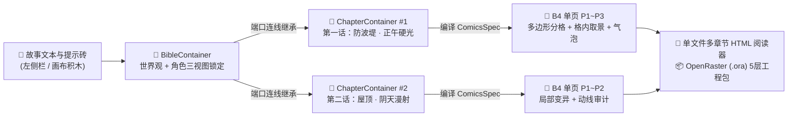

<div align="center">

# 🎨 tldraw-manga

**基于 tldraw 5.5 与 Electron 构建的纯鼠标驱动漫剧分镜与多边形排版工作台**  
*Mouse-Driven Manga Storyboard, Polygon Layout & Multi-Chapter Publishing Studio*

[](https://github.com/jstdlee/tldraw-manga/actions/workflows/build-desktop.yml)
[](https://github.com/jstdlee/tldraw-manga/releases/latest)
[](#-%E6%A1%8C%E9%9D%A2%E7%AB%AF%E4%B8%8B%E8%BD%BD%E4%B8%8E%E5%BF%AB%E9%80%9F%E5%BC%80%E5%A7%8B)
[](https://www.typescriptlang.org/)
[](https://tldraw.dev)
[](#5-%E9%9B%B6-key-%E7%A6%BB%E7%BA%BF%E7%BD%91%E7%82%B9%E6%89%8B%E7%BB%98%E5%BC%95%E6%93%8E--%E5%A4%9A%E6%BA%90-api-%E6%9C%AC%E5%9C%B0%E4%BB%A3%E7%90%86)

<p align="center">
  <a href="#-%E6%A0%B8%E5%BF%83%E4%BA%AE%E7%82%B9">核心亮点</a> •
  <a href="#-%E5%85%B8%E5%9E%8B%E5%88%9B%E4%BD%9C%E6%B5%81%E7%A8%8B%E5%AE%9E%E6%9C%BA%E6%88%AA%E5%9B%BE">典型流程截图</a> •
  <a href="#-%E6%A1%8C%E9%9D%A2%E7%AB%AF%E4%B8%8B%E8%BD%BD%E4%B8%8E%E5%BF%AB%E9%80%9F%E5%BC%80%E5%A7%8B">桌面端下载与运行</a> •
  <a href="#-%E6%9E%B6%E6%9E%84%E4%B8%8E%E7%9B%AE%E5%BD%95%E7%BB%93%E6%9E%84">项目架构</a> •
  <a href="#-%E9%9A%90%E7%A7%81%E4%B8%8E%E5%AE%89%E5%85%A8">隐私与安全</a>
</p>


*▲ 画布启动默认预置完整的 **《海鸥抢薯条》演示工作台**（1 个 `BibleContainer` 设定母容器 + 2 个 `ChapterContainer` 章节容器 + 5 张 B4 漫画单页，已按 `设定 → 章节 → 单页` 连线完毕），所有分格、取景、气泡与发布操作均可通过鼠标直觉完成。*

</div>

---

## ✨ 核心亮点

### 1. 🧩 三级智能容器连线与局部覆盖 (`设定 → 章节 → 单页`)
- **母容器 (`BibleContainer`)**：集中收纳故事大纲、世界观规则、全局画风（少年网点 / 少女淡彩 / 硬诺瓦尔 / 港风水墨）与带三视图的角色锁定卡（`@kanta`、`@mei`、`@boss`）。
- **章节容器 (`ChapterContainer`)**：通过端口连线自动继承母容器设定，支持按话覆盖**场景环境**与**主光源**（如第 1 话「盐风 · 正午硬光」→ 第 2 话「屋顶 · 阴天漫射」）。
- **B4 漫画单页容器 (`PageContainer`)**：遵守日本商业漫画 B4 完稿比例（`760×1075` 逻辑坐标，安全内框出血控制），支持单页独立调节情绪曲率（`establishing / tension / intimacy / action / reveal / climax`）、分格密度与机位参数。

### 2. 📐 确定性多边形斜切分格引擎 + 毫秒级 `layoutScore` 四选一
- **拒绝呆板方格**：基于确定性 PRNG (`mulberry32`) 生成带动态斜切角（刀口切线 ≤ 12°）、防夹角过尖与最小可视面积约束的多边形分镜面板。
- **实时多维评分 (`layoutScore`)**：从格数匹配度、斜切平衡度、入口/落幅焦点比、情绪契合度四个维度实时打分；点击 **`[四选一]`** 可在 `< 1 ms` 内从 36 组候选基因组中筛出最高分 Top 4 供一键切换。
- **红线中缝手柄直拖**：直接用鼠标拖动分镜格之间的红色分割手柄（Gutter Handles），实时改变行列宽度比与斜切角度，气泡与分镜构图同步自适应。

### 3. 🖼️ 生图前安全区预构图 + 生图后格内 `<clipPath>` 相框推拉模式
- **生图前（Pre-generation Safe-Zone Framing）**：自动根据每个多边形面板的外接宽高比（`16:9` / `4:3` / `1:1` / `3:4` / `9:16`）与气泡所在角落（如 `top-right`）注入 **12% 裁剪出血余量** 与 **20% 对白留白安全区**。
- **生图后（In-Panel Crop Mode）**：**双击任意分镜格**（或点底部栏 **`[✥ 格内移图]`**），多边形外框保持锁定，鼠标在格内直接拖拽平移底图、滚轮缩放（`0.45x ~ 3.4x`）或拉动旋转滑块（`-25° ~ +25°`），彻底解决「画面裁切到角色头顶」或「气泡挡脸」的痛点。

### 4. 💬 7 种参数化 SVG 矢量气泡 + 声优语气标签 + 👁️ 阅读动线审计
- **7 种矢量气泡样式**：内置 `speech`（普通对白）、`thought`（心理云朵）、`caption`（旁白方框）、`whisper`（虚线低语）、`shout`（放射炸裂）、`broadcast`（机械折线）、`sfx`（拟声词倾斜字）。
- **蓝点尾巴拖拽与声优语气**：拖动气泡上的蓝色圆点即可将尾巴精准指向角色嘴部；底部栏一键挂载 `[冷笑]`、`[颤抖]`、`[怒吼]`、`[低语]`、`[停顿]` 等语气标签与字号强调。
- **右→左阅读动线叠加层 (`👁️ 阅读动线`)**：一键在画布上叠加**红线**（日漫右→左、上→下分镜扫视路径）、**蓝虚线**（跨格气泡阅读串联顺序）与**绿线**（格内角色视线引导向量）。

### 5. 🎨 零 Key 离线网点手绘引擎 + 多源 API 本地代理
- **零配置开箱即绘**：无需任何 API Key，点击任意渲染按钮即可由内置离线插画引擎生成包含黑白网点（Screentone）、速度线、角色剪影与道具细节的漫画稿。
- **一键接入主流大模型**：在左侧栏打开 **`[图像 / 文本 API]`**，即可通过本地安全代理（`/api/complete`、`/api/image`）无缝切换 **OpenAI**、**Google Gemini**、**OpenRouter** 或 **本地 OpenAI 兼容接口（Ollama / vLLM / SD-WebUI）**；接口异常时自动平滑回退至离线手绘网点稿。

### 6. 📖 多章节单文件交互式 `.html` 阅读器 & 📦 `.ora` 分层工程包导出
- **单文件离线 `.html` 漫画阅读器**：框选任意章节或单页（不选默认导出全书），一键生成零外部依赖的单文件 `.html`，内嵌章节目录跳转、**日漫右翻双页 / 条漫纵向瀑布流 / 分镜格逐格推镜**三种阅读模式、台词气泡与导演动线图层开关，以及**特典角色设定集附录**。
- **专业绘师 `.ora` (OpenRaster) 5 层工程包**：一键打包 `.zip`，每页包含标准 `.ora` 分层文件（`05-Director` 动线层、`04-Bubbles` 气泡层、`03-Ink-Frames` 多边形框线层、`02-Panel-Art` 分镜画面层、`01-Paper` 纸张底色层）及高清矢量 `.svg`，可直接拖入 **Clip Studio Paint / Krita / GIMP** 二次精修。

---

## 🎬 典型创作流程实机截图

### 整体工作流架构



---

### Step 1 & 2 · 全景工作台与三级容器连线 (`设定 → 章节 → 单页`)

点击顶栏 **`[🚀 一键出漫]`**（或依次点击 **`[⚡ 一键设定集]`** → **`[📚 一键分章]`**），工作台自动从故事文本提炼出角色锁定卡与世界观规则，建立 `BibleContainer → ChapterContainer → PageContainer` 三级容器连线，并铺开全部章节与 B4 漫画页：


---

### Step 3 · 确定性多边形分格引擎与毫秒级 `四选一` 评分器

选中任意漫画单页，点击底部工具栏的 **`[四选一]`**（或顶栏 **`[🎲 换分格]`** / **`[🧬 局部变异]`**），系统在毫秒内对 36 个确定性多边形分格种子进行 `layoutScore` 评分，弹出 Top 4 候选布局及得分理由，点击任意候选卡片即可无损切换分格：


---

### Step 4 · 红线中缝拖拽、格内相框推拉取景与 7 种声优气泡

- **调分格**：直接拖拽页面上的**红白圆形中缝手柄**实时改变面板比例与斜切角度。
- **调取景（相框模式）**：**双击任意分镜格**进入格内移图模式（红框高亮），在多边形外框锁定的状态下自由拖拽平移底图，或使用底部栏的 **`缩放`**、**`旋转`** 滑块微调构图。
- **调气泡与语气**：点击气泡并拖动**蓝色尾巴圆点**指向角色嘴部，在底部工具栏一键切换 7 种气泡外框（`speech / thought / caption / whisper / shout / broadcast / sfx`）与声优语气标签（`[冷笑]`、`[颤抖]`、`[怒吼]` 等）：


---

### Step 5 · 日漫右→左阅读动线审计叠加层 (`👁️ 阅读动线`)

点击底部工具栏 **`[👁️ 阅读动线]`**，画布即刻在分镜页上方叠加视觉动线审计层：
- 🔴 **红色折线**：日漫标准右→左（RTL）分镜扫视路径；
- 🔵 **蓝色虚线**：跨格对白气泡的阅读串联顺序；
- 🟢 **绿色向量**：格内角色的视线引导方向，帮助创作者一眼排查逆向气泡或跳格隐患。


---

### Step 6 · 多章节交互式 HTML 整书预览与分层 `.ora` 导出

点击顶栏 **`[📖 整书预览]`** 即可在应用内唤起多章节漫画阅读器（点击 **`[📥 导出 HTML]`** 则直接下载单文件离线网页，点击 **`[📦 导出 ORA]`** 下载分层压缩包）。阅读器内置：
- **三种阅读模式**：`日漫右翻双页`、`条漫纵向滚动`、`分镜格逐格推镜`（支持键盘方向键与数字键 `1/2/3` 快捷切换）；
- **无损图层开关**：随时单独开关 `台词气泡` 与 `导演分镜与动线`；
- **特典设定集**：一键查看全书世界观规则与角色三视图设定卡。


---

## 🚀 桌面端下载与快速开始

### 1. 直接下载独立桌面端 (`Release v0.1.0`)

本项目已配置 GitHub Actions 多架构流水线，每次发布标签自动编译 **Linux ARM64** 与 **Windows x64** 独立桌面程序（内嵌本地静态资源与 `/api/*` 代理服务，无需安装 Node.js 或外部浏览器）：

| 平台与架构 | 打包格式 | 下载链接 | 说明 |
| :--- | :--- | :--- | :--- |
| **Linux ARM64** (`aarch64`) | `.AppImage` | [**tldraw-manga-0.1.0-arm64.AppImage**](https://github.com/jstdlee/tldraw-manga/releases/download/v0.1.0/tldraw-manga-0.1.0-arm64.AppImage) | 单文件免安装，`chmod +x` 后直接运行 |
| **Linux ARM64** (`aarch64`) | `.tar.gz` | [**tldraw-manga-0.1.0-arm64.tar.gz**](https://github.com/jstdlee/tldraw-manga/releases/download/v0.1.0/tldraw-manga-0.1.0-arm64.tar.gz) | 解压后运行 `./tldraw-manga` |
| **Windows x64** (`64-bit`) | Portable `.exe` | [**tldraw-manga.0.1.0.exe**](https://github.com/jstdlee/tldraw-manga/releases/download/v0.1.0/tldraw-manga.0.1.0.exe) | 便携单文件版，双击即开 |
| **Windows x64** (`64-bit`) | `.zip` | [**tldraw-manga-0.1.0-win.zip**](https://github.com/jstdlee/tldraw-manga/releases/download/v0.1.0/tldraw-manga-0.1.0-win.zip) | 免安装绿色解压包 |

> 📦 全部历史版本与校验信息请访问 [**GitHub Releases 页面**](https://github.com/jstdlee/tldraw-manga/releases)。

---

### 2. 本地 Web 开发与运行

环境要求：**Node.js >= 20**（推荐 Node 22 / 24）。

```bash
# 1. 克隆仓库并安装依赖
git clone https://github.com/jstdlee/tldraw-manga.git
cd tldraw-manga
npm install

# 2. 启动本地开发服务器（默认监听 http://127.0.0.1:43123）
npm run dev
```

常用质量校验与构建命令：

```bash
npm run lint     # 运行 oxlint 静态检查
npm test         # 运行 Vitest 单元测试（分格几何、导出包完整性与路由测试）
npm run build    # TypeScript 类型检查 + 生产环境前端构建 (dist/)
```

---

### 3. Electron 桌面端开发与跨平台打包

```bash
# 启动 Electron 桌面开发环境（自动拉起 Vite 与本地 API 代理窗口）
npm run electron:dev

# 编译打包 Linux ARM64 桌面端 (生成至 release/)
npm run dist:linux-arm64

# 编译打包 Windows x64 桌面端 (生成至 release/)
npm run dist:win-x64

# 一键同时打包 Linux ARM64 与 Windows x64
npm run dist:all
```

---

## 🗂️ 架构与目录结构

```text
tldraw-manga/
├── electron/
│   ├── main.mjs                  # Electron 主进程：内嵌回环 HTTP 服务与 /api/* 代理
│   └── preload.cjs               # 安全上下文桥接 (contextIsolation: true)
├── server/
│   ├── apiHandler.ts             # 多源 LLM / 图像生成本地代理（OpenAI / Gemini / OpenRouter / Local）
│   └── apiPlugin.ts              # Vite 开发与预览中间件挂载
├── src/
│   ├── App.tsx                   # 工作台根布局与 tldraw 画布挂载
│   └── studio/
│       ├── demo/book.ts          # 《海鸥抢薯条》默认多章节剧本与世界观数据
│       ├── layout/
│       │   ├── engine.ts         # 确定性多边形分格生成、红线中缝拖拽与几何裁剪
│       │   └── score.ts          # layoutScore 多维评分与 Top 4 候选筛选器
│       ├── render/
│       │   ├── illustrator.ts    # 零 Key 离线黑白网点、速度线与角色三视图手绘引擎
│       │   ├── bubbles.ts        # 7 种参数化矢量气泡与尾巴路径生成
│       │   └── pageSvg.ts        # B4 漫画页完整 SVG 合成（含 <clipPath> 相框矩阵与动线层）
│       ├── shapes/               # tldraw 自定义图形：MangaContainer / MangaCard / MangaBubble / MangaPrompt
│       ├── spec/compile.ts       # 沿画布连线拓扑自动编译 ComicsSpec v1 JSON
│       ├── export/
│       │   ├── htmlReader.ts     # 单文件多章节交互式 HTML 阅读器生成器
│       │   └── ora.ts            # OpenRaster (.ora) 5 层精修工程包与 ZIP 打包器
│       └── ui/chrome.tsx         # 顶栏宏按钮、左侧积木栏、底部上下文工具条与模态窗
└── .github/workflows/
    └── build-desktop.yml         # GitHub Actions 自动测试、跨平台编译与 Release 发布流水线
```

---

## 🔒 隐私与安全

- **零云端遥测**：画布状态保存在浏览器或桌面端本地 IndexedDB（`persistenceKey="tldraw-manga"`），导出的 `.html`、`.ora` 与 `.json` 完全在本地生成。
- **密钥不落盘不外泄**：在 UI 中填写的 API Key 仅保存在本机 `localStorage` 并发往本机回环接口（`127.0.0.1` 的 `/api/complete` 与 `/api/image`），也可直接通过系统环境变量（`OPENAI_API_KEY`、`GEMINI_API_KEY`、`OPENROUTER_API_KEY`、`LOCAL_LLM_BASE_URL`）注入，绝不经过任何第三方中转服务器。
