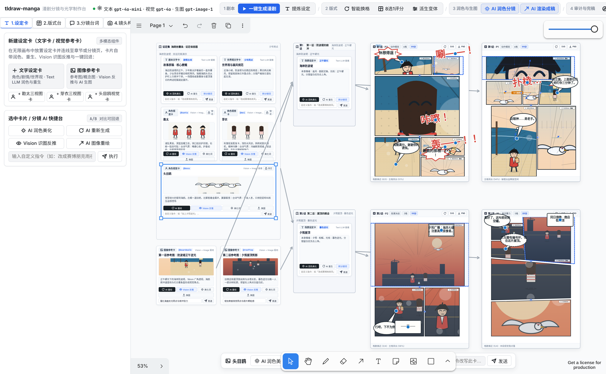
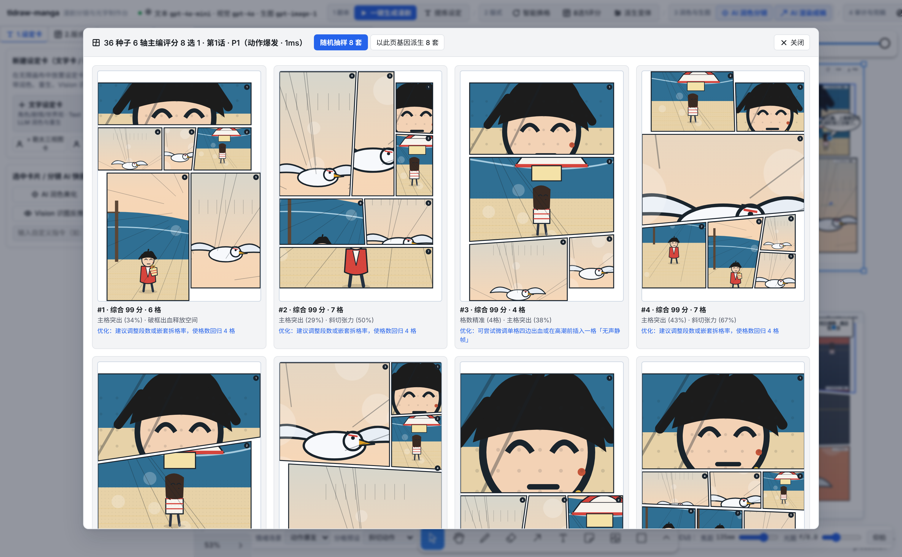
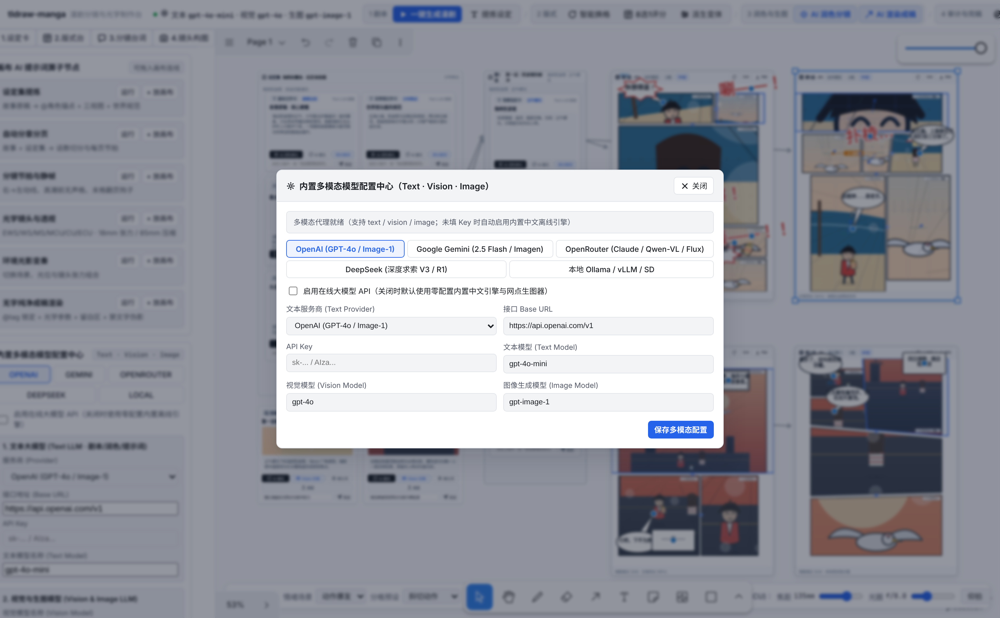

<div align="center">

# tldraw-manga

**基于 tldraw 5.5 与 Electron 构建的 AI 多模态漫剧分镜、多边形版式与光学镜头制作台（原生 tldraw Paper/Dark 视觉规范 · 100% 纯中文）**  
*Native tldraw Multimodal LLM (Text · Vision · Image) Manga Storyboard, Polygon Layout, Optical Shot Lab & Multi-Chapter Publishing Studio*

[](https://github.com/jstdlee/tldraw-manga/actions/workflows/build-desktop.yml)
[](https://github.com/jstdlee/tldraw-manga/releases/latest)
[](#桌面端下载与快速开始)
[](https://www.typescriptlang.org/)
[](https://tldraw.dev)
[](#核心亮点)

<p align="center">
  <a href="#核心亮点">核心亮点</a> •
  <a href="#渐进式漫画创作流程实机截图">实机截图</a> •
  <a href="#桌面端下载与快速开始">桌面端下载与运行</a> •
  <a href="#架构与目录结构">项目架构</a> •
  <a href="#隐私与安全">隐私与安全</a>
</p>


*▲ 采用与 tldraw 5.5 原生一脉相承的 **Paper / Dark 极简工程制图视觉语言**（`--tl-color-panel`、`--tl-color-background`、`1px` 精细分割线、纯单色 SVG 线性图标、零 Emoji 堆砌）。功能按 **渐进式创作阶段 (`1. 设定卡 → 2. 版式台 → 3. 分镜台词 → 4. 镜头构图 → 5. 模型节点`)** 与 **当前画布选中上下文** 自然展开，保持画布始终如漫画家的制图桌面般安静、克制。*

</div>

---

## 核心亮点

### 1. 原生 tldraw 视觉语言与上下文渐进式披露 (Progressive Disclosure)
- **原生 tldraw Paper / Dark 双主题**：完全对齐 tldraw 5.5 的色彩令牌（`--tl-color-panel`、`--tl-color-background`、`--tl-color-muted-2`、`--tl-color-divider`、`--tl-color-text-1`）与圆角、阴影规范，支持顶栏一键切换明暗主题并实时同步 tldraw 画布。
- **画布静默与按需披露**：画布上的漫画单页默认呈现纯净的 **B4 漫画原稿纸**（仅含标题、版式标签、格数与主编评分）；只有按序切换至对应制作阶段，或在画布中点选 **某张设定卡 / 某页原稿 / 某个具体分镜格** 时，左侧检查器与顶部上下文条才会精准展开当前阶段所需的专业操控面板。

### 2. Stage 1 · 设定卡与多模态 AI 快捷台 (`1. 设定卡`)
- **文字设定卡 (`Text Card`)**：支持一键执行 **`AI 润色美化`**、**`AI 重新生成`**、**`转分镜提示词`**、自定义指令改写，以及修改前后的 **A/B 版本一键回滚**。
- **图像参考卡 (`Image Card`) & 角色三视图锁 (`@kanta` / `@mei` / `@boss`)**：支持 **`AI 图像重绘`**（调用 `/api/image`）、**`Vision 识图反推`**（调用 `/api/vision` 从参考图提取外貌、构图与光影描述）、本地参考图上传及自定义改图指令。

### 3. Stage 2 · 版式工作台、几何参数与主编 6 轴可执行处方 (`2. 版式台`)
- **4 大经典版式预设 × 5 种画幅比例 × 4 档段数范围**：
  - 预设：`整然叙事 (seizen)` / `标准少年 (std)` / `动作斜切 (action)` / `大开扉页 (tobira)`；
  - 画幅：`B4 日漫原稿 (0.708)` / `A4 国际漫 (0.707)` / `条漫竖屏 (0.500)` / `四格漫画 (0.480)` / `宽银幕分镜 (1.500)`；
  - 段数范围：`1–3 段` / `2–3 段` / `2–4 段` / `3–4 段`。
- **5 维几何参数实时精调**：`斜切度 (Slant)`、`破框出血率 (Bleed)`、`嵌套拆格率 (Sub-split)`、`大格权重 (Big Weight)`、`框线粗细 (Line Width 1.5–6px)`，并支持 **`以此页基因派生微调变体`**。
- **36 种子 6 轴主编评分 (`layoutScore`) 与一键可执行处方**：
  - 实时计算 `格数契合 / 主格突出 / 斜切张力 / 纵横韵律 / 视线落点 / 破框呼吸` 6 轴得分；
  - 针对诊断出的薄弱维度自动生成 **一键可执行修复按钮**（如 **`强化末格翻页钩子`**、**`拉开主次格面积对比`**、**`注入斜切与出血动势`**、**`收拢刀口回归整然叙事`**），点击即刻重算并更新画布页面；
  - 支持打开 **8 选 1 候选版式工作台** 对比筛选。

### 4. Stage 3 · 情绪分镜锦囊、无声留白格与 7 种矢量气泡 (`3. 分镜台词`)
- **6 档情绪分镜锦囊 (`情绪分镜策略一键套用`)**：内置 `建立场景 / 压迫逼近 / 亲密对话 / 冲击瞬间 / 悬念揭晓 / 终局高潮` 六大导演策略，点击即可自动重排整页各格的景别序列、机位俯仰、焦距与视觉高潮格。
- **无声留白格 (`Silent Panel`)**：选中任意分镜格即可一键切换「无声留白格」，自动清空该格对白气泡、切换为环境空镜/凝视节拍并重新编译页面。
- **7 种参数化中文矢量气泡与语气标注**：普通对白、心理云朵、旁白方框、低语虚线、怒吼炸裂、广播折线、地道中文拟声词（`唰——！`、`咔嚓！`、`轰——！！`、`盯——！`），支持尾巴蓝点直拖与整页台词 AI 润色。

### 5. Stage 4 · 光学镜头实验室 (Optical Shot Lab)、四边独立出血与构图辅助线 (`4. 镜头构图`)
- **光学镜头联动 (Optical Shot Lab)**：点选页面内任意分镜格（`第 N 格`），即可调节物理相机三要素：
  - **焦距 (`12mm – 200mm`)**、**光圈 (`f/1.4 – f/22`)**、**物距 (`0.5m – 20m`)**；
  - 实时物理推导 **等效焦距、水平视场角 (FOV°)、推导景别 (`EWS / WS / MS / MCU / CU / ECU`)、景深虚化强度 (DOF%) 与透视畸变**，并实时同步驱动格内 SVG 画面取景缩放与背景虚化渲染。
- **格内精细取景、四边独立出血 (`bT / bB / bL / bR`) 与纵切子格**：
  - 支持格内推拉缩放 (`0.6x–2.4x`)、画面倾角 (`-25°~+25°`)、双击格内拖拽平移；
  - 支持 **上 (`bT`) / 下 (`bB`) / 左 (`bL`) / 右 (`bR`) 四边独立破框出血开关**，以及将当前格 **一键纵切拆分为 2 个子格**。
- **专业漫画构图辅助叠加层**：支持按需开启 **`B4 版心安全内框 (Safe Margin)`**、**`九宫格三分线 (Rule of Thirds)`**、**`180° 轴线与视线越轴检查`** 与 **`右→左阅读动线叠加层`**。

### 6. Stage 5 & 完稿导出 · 多模态配置、单页 PNG/SVG、5 层 ORA 与四模式 HTML 阅读器
- **三路独立多模态模型配置**：Text LLM (`/api/complete`)、Vision LLM (`/api/vision`)、Image Gen (`/api/image`)，支持 OpenAI / Google Gemini / OpenRouter / DeepSeek / 本地 Ollama 一键预设与零配置离线网点手绘引擎兜底。
- **全规格专业完稿导出**：
  - **单页高清导出**：一键导出当前页 **`2400px 印刷级 PNG`** 或 **`无损矢量 SVG`**；
  - **`.ora` (OpenRaster) 5 层精修工程包**：包含 `ReadingFlow`（动线与构图检查层）、`Bubbles`（气泡台词层）、`PanelBorders`（多边形框线层）、`PanelArt`（分镜画面层）、`Paper`（原稿纸底色层），可直接拖入 **Clip Studio Paint / Krita / GIMP** 分层精修；
  - **单文件离线 `.html` 四模式阅读器**：内嵌 `日漫右翻双页`、`条漫纵向滚动`、`分镜格逐格推镜`、`角色与世界设定集`。

---

## 渐进式漫画创作流程实机截图

### 1 · 版式工作台 (`2. 版式台`)、5 维几何滑杆、主编 6 轴评分与一键可执行处方

选中漫画单页并处于 `2. 版式台` 阶段时，左栏精准呈现 4 大版式预设、画幅比例、5 维几何参数滑杆以及 **主编 6 轴评分 + 一键可执行修复按钮**（如底部的 `强化末格翻页钩子`）：


---

### 2 · 设定卡工作台 (`1. 设定卡`)、分镜格光学推拉与顶部渐进式上下文操控条

选中设定卡或点选画布内的具体分镜格时，左侧检查器与画布顶部浮动条按上下文展示卡片 AI 快捷操作（`AI 润色美化` / `Vision 识图反推` / `AI 图像重绘`）或当前分镜格的 **光学焦距 (`12–200mm`)、光圈 (`f/1.4–f/22`) 与无声格开关**：



---

### 3 · 36 种子 6 轴主编评分 `8 选 1` 候选版式工作台

点击 **`8选1评分`**，系统在毫秒内基于当前基因派生或全局采样 36 组多边形分格方案，筛出 Top 8 候选版式并展示各方案的主编评分理由与优化建议，点击任意卡片即可无损套用：



---

### 4 · 内置多模态大模型配置中心（Text · Vision · Image）

点击顶栏模型状态胶囊或进入 `5. 模型节点` 分页，可独立配置 **文本模型 (Text LLM)**、**视觉模型 (Vision LLM)** 与 **图像生成模型 (Image Model)**，支持 5 大主流服务商预设一键切换：



---

### 5 · 整书四模式阅读器与单页 `2400px PNG / SVG` 完稿导出

点击顶栏 **`整书预览`**，即可在应用内交互式预览 `日漫右翻双页`、`条漫纵向滚动`、`分镜格逐格推镜` 与 `角色与世界设定集`，或直接导出当前页 `2400px PNG`、`单页 SVG`、`.ora` 5 层工程包与单文件离线 `.html` 阅读器：


---

## 桌面端下载与快速开始

### 1. 直接下载独立桌面端 (`Release v0.2.0`)

本项目已配置 GitHub Actions 多架构流水线，自动编译 **Linux ARM64** 与 **Windows x64** 独立桌面程序（内嵌本地静态资源与 `/api/complete`、`/api/vision`、`/api/image` 多模态代理服务）：

| 平台与架构 | 打包格式 | 下载链接 | 说明 |
| :--- | :--- | :--- | :--- |
| **Linux ARM64** (`aarch64`) | `.AppImage` | [**tldraw-manga-0.2.0-arm64.AppImage**](https://github.com/jstdlee/tldraw-manga/releases/download/v0.2.0/tldraw-manga-0.2.0-arm64.AppImage) | 单文件免安装，`chmod +x` 后直接运行 |
| **Linux ARM64** (`aarch64`) | `.tar.gz` | [**tldraw-manga-0.2.0-arm64.tar.gz**](https://github.com/jstdlee/tldraw-manga/releases/download/v0.2.0/tldraw-manga-0.2.0-arm64.tar.gz) | 解压后运行 `./tldraw-manga` |
| **Windows x64** (`64-bit`) | Portable `.exe` | [**tldraw-manga.0.2.0.exe**](https://github.com/jstdlee/tldraw-manga/releases/download/v0.2.0/tldraw-manga.0.2.0.exe) | 便携单文件版，双击即开 |
| **Windows x64** (`64-bit`) | `.zip` | [**tldraw-manga-0.2.0-win.zip**](https://github.com/jstdlee/tldraw-manga/releases/download/v0.2.0/tldraw-manga-0.2.0-win.zip) | 免安装绿色解压包 |

> 全部版本与校验信息请访问 [**GitHub Releases 页面**](https://github.com/jstdlee/tldraw-manga/releases)。

---

### 2. 本地 Web 开发与运行

环境要求：**Node.js >= 20**（推荐 Node 22 / 24）。

```bash
# 1. 克隆仓库并安装依赖
git clone https://github.com/jstdlee/tldraw-manga.git
cd tldraw-manga
npm install

# 2. 启动本地开发服务器
npm run dev
```

常用质量校验与构建命令：

```bash
npm run lint     # 运行 oxlint 静态检查
npm test         # 运行 Vitest 单元测试（分格几何、导出包完整性与 Text/Vision/Image 路由测试）
npm run build    # TypeScript 类型检查 + 生产环境前端构建 (dist/)
```

---

### 3. Electron 桌面端开发与跨平台打包

```bash
# 启动 Electron 桌面开发环境（自动拉起 Vite 与本地多模态 API 代理窗口）
npm run electron:dev

# 编译打包 Linux ARM64 桌面端 (生成至 release/)
npm run dist:linux-arm64

# 编译打包 Windows x64 桌面端 (生成至 release/)
npm run dist:win-x64

# 一键同时打包 Linux ARM64 与 Windows x64
npm run dist:all
```

---

## 架构与目录结构

```text
tldraw-manga/
├── electron/
│   ├── main.mjs                  # Electron 主进程：内嵌回环 HTTP 服务与 /api/* 多模态代理
│   └── preload.cjs               # 安全上下文桥接 (contextIsolation: true)
├── server/
│   ├── apiHandler.mjs            # 文本(/api/complete)、视觉(/api/vision)、生图(/api/image)本地代理与离线回退
│   └── apiPlugin.ts              # Vite 开发与预览中间件挂载
├── src/
│   ├── App.tsx                   # 原生 tldraw 双主题工作台外壳与组件挂载
│   └── studio/
│       ├── demo/book.ts          # 《海鸥抢薯条》全中文剧本、设定、图像参考卡与中文拟声词
│       ├── editor/pipeline.ts    # 设定卡/分镜页 AI 管线、情绪分镜策略、主编处方一键修复与光学联动
│       ├── layout/
│       │   ├── engine.ts         # 确定性多边形分格生成、5 种画幅比例、四边出血、纵切子格与基因变异
│       │   └── score.ts          # 6 轴主编评分 (layoutScore) 与一键可执行修复处方生成
│       ├── optics/
│       │   └── lens.ts           # Optical Shot Lab：焦距(12-200mm)/光圈/物距 → FOV/景别/DOF 物理推导
│       ├── render/
│       │   ├── illustrator.ts    # 零 Key 离线黑白网点、角色三视图与光学景深虚化渲染引擎
│       │   ├── bubbles.ts        # 7 种参数化矢量气泡、尾巴路径与纯中文拟声词渲染
│       │   └── pageSvg.ts        # 原稿 SVG 合成（含 <clipPath> 相框矩阵、四边独立出血与构图辅助线）
│       ├── shapes/               # tldraw 自定义图形：MangaContainer / MangaCard / MangaBubble / MangaPrompt
│       ├── spec/compile.ts       # 沿画布连线拓扑自动编译 ComicsSpec v1 JSON
│       ├── export/
│       │   ├── htmlReader.ts     # 单文件多章节交互式四模式 HTML 阅读器生成器
│       │   └── ora.ts            # OpenRaster (.ora) 5 层精修工程包、2400px PNG 与 SVG 导出器
│       └── ui/
│           ├── icons.tsx         # 16×16 1.5px 单色 SVG 线性图标集（零 Emoji）
│           └── chrome.tsx        # 渐进式 5 阶段工作台、上下文检查器、8 选 1 候选窗与四模式预览窗
└── .github/workflows/
    └── build-desktop.yml         # GitHub Actions 自动测试、跨平台编译与 Release 发布流水线
```

---

## 隐私与安全

- **零云端遥测**：画布状态保存在浏览器或桌面端本地 IndexedDB，导出的 `.html`、`.ora`、`.png`、`.svg` 与 `.json` 完全在本地生成。
- **密钥不落盘不外泄**：在 UI 中填写的 Text / Vision / Image API Key 仅保存在本机 `localStorage` 并发往本机回环接口（`127.0.0.1` 的 `/api/complete`、`/api/vision` 与 `/api/image`），也可直接通过系统环境变量（`OPENAI_API_KEY`、`GEMINI_API_KEY`、`OPENROUTER_API_KEY`、`LOCAL_LLM_BASE_URL`）注入，绝不经过任何第三方中转服务器。
