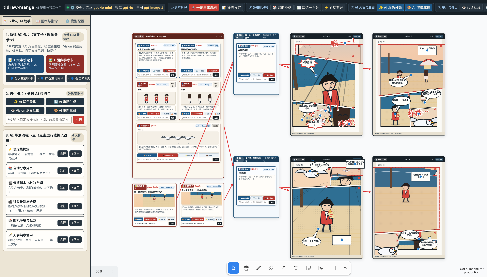
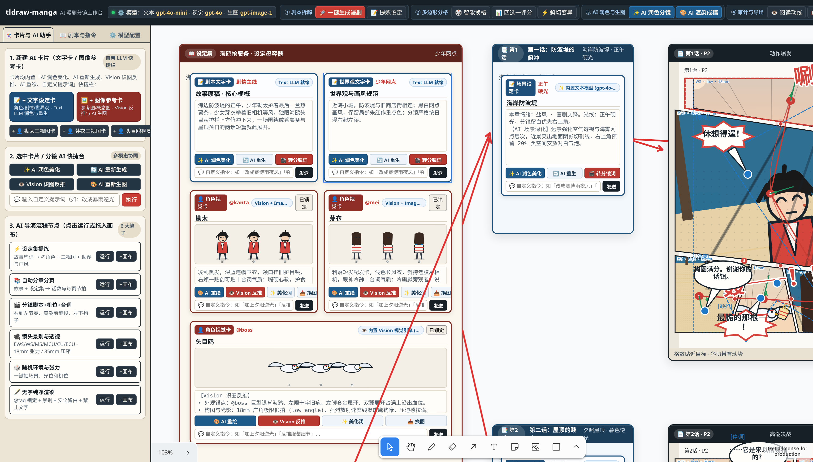
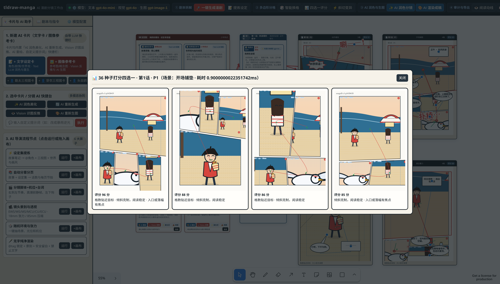
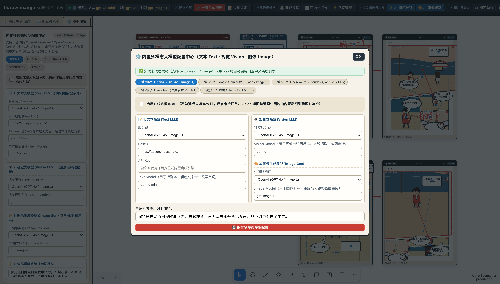
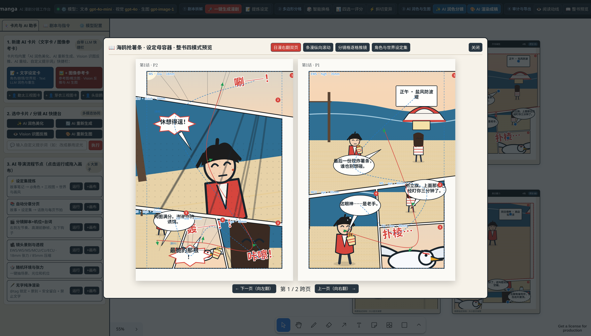

<div align="center">

# 🎨 tldraw-manga

**基于 tldraw 5.5 与 Electron 构建的 AI 多模态漫剧分镜与多边形排版工作台（100% 纯中文）**  
*Multimodal LLM (Text · Vision · Image) Manga Storyboard, Polygon Layout & Multi-Chapter Publishing Studio*

[](https://github.com/jstdlee/tldraw-manga/actions/workflows/build-desktop.yml)
[](https://github.com/jstdlee/tldraw-manga/releases/latest)
[](#-%E6%A1%8C%E9%9D%A2%E7%AB%AF%E4%B8%8B%E8%BD%BD%E4%B8%8E%E5%BF%AB%E9%80%9F%E5%BC%80%E5%A7%8B)
[](https://www.typescriptlang.org/)
[](https://tldraw.dev)
[](#1--%E6%96%87%E5%AD%97%E5%8D%A1%E4%B8%8E%E5%9B%BE%E5%83%8F%E5%8D%A1%E5%8E%9F%E7%94%9F%E6%8E%A5%E5%85%A5%E5%A4%9A%E6%A8%A1%E6%80%81-llm%E6%96%87%E6%9C%AC--vision--%E7%94%9F%E5%9B%BE)

<p align="center">
  <a href="#-%E6%A0%B8%E5%BF%83%E4%BA%AE%E7%82%B9">核心亮点</a> •
  <a href="#-%E5%85%B8%E5%9E%8B%E5%88%9B%E4%BD%9C%E6%B5%81%E7%A8%8B%E5%AE%9E%E6%9C%BA%E6%88%AA%E5%9B%BE">典型流程截图</a> •
  <a href="#-%E6%A1%8C%E9%9D%A2%E7%AB%AF%E4%B8%8B%E8%BD%BD%E4%B8%8E%E5%BF%AB%E9%80%9F%E5%BC%80%E5%A7%8B">桌面端下载与运行</a> •
  <a href="#-%E6%9E%B6%E6%9E%84%E4%B8%8E%E7%9B%AE%E5%BD%95%E7%BB%93%E6%9E%84">项目架构</a> •
  <a href="#-%E9%9A%90%E7%A7%81%E4%B8%8E%E5%AE%89%E5%85%A8">隐私与安全</a>
</p>



*▲ 画布启动默认预置完整的 **《海鸥抢薯条》全中文演示工作台**（顶栏清晰的 **`① 剧本拆解 → ② 多边形分格 → ③ AI 润色与生图 → ④ 审计与导出`** 四步流水线 + 左栏三大功能分页 + 画布内文字设定卡 `Text Card`、图像参考卡 `Image Card` 与三级容器连线，且与底部原生 tldraw 工具栏**零重叠**）。*

</div>

---

## ✨ 核心亮点

### 1. 🤖 文字卡 (`Text Card`) 与图像卡 (`Image Card`) 原生接入多模态 LLM（文本 · Vision · 生图）
- **📝 文字设定卡 (`Text Card`)**：卡片内嵌 **`[✨ AI 润色]`**、**`[🔄 AI 重生]`**、**`[🎬 转分镜词]`** 快捷按钮与 **`💬 自定义提示词改写栏`**，随时用 Text LLM 扩写设定、改写分镜或转换镜头语言。
- **🖼️ 图像参考卡 (`Image Card`) & 👤 角色视觉卡**：卡片内嵌 **`[🎨 AI 重绘]`**（调用 Image LLM 重新生成参考图）、**`[👁️ Vision 反推]`**（调用 Vision LLM `/api/vision` 识别画面并自动提取角色外貌、构图与光影描述）、**`[✨ 美化词]`**、**`[📤 换图]`**（上传本地参考图识别）以及 **`💬 自定义改图指令`**。
- **⚙️ 内置多模态模型配置中心**：顶栏胶囊与左栏第三分页随时配置三路独立模型：
  1. **文本大模型 (Text LLM)**：用于剧本拆分、台词润色、分镜扩写与提示词美化；
  2. **视觉大模型 (Vision LLM)**：用于参考图反推人设描述、画面构图审计（`/api/vision`）；
  3. **图像生成模型 (Image Gen)**：用于图像参考卡与分镜格画面生成（`/api/image`），并支持 OpenAI / Google Gemini / OpenRouter / DeepSeek / 本地 Ollama 一键预设切换及零 Key 离线网点引擎兜底。

### 2. 🧭 逻辑清晰的四步顶栏 + 三栏左抽屉 + 零重叠画布布局
- **与 tldraw 原生工具栏零碰撞**：采用独立 Grid 工作台外壳，隐藏冗余原生浮窗，底部居中保留纯净的 tldraw 画布工具条（选择、抓手、连线箭头、缩放），而漫剧专属的**上下文 AI 快捷条**停靠在画布顶部，彻底杜绝工具栏重叠。
- **顶栏四步流水线**：按创作先后顺序组织为 `① 剧本拆解` → `② 多边形分格` → `③ AI 润色与生图` → `④ 审计与导出`。
- **左栏三大清晰分页**：
  - `🃏 卡片与 AI 助手`：新建文字卡/图像卡、当前选中项 AI 快捷台、可拖拽 AI 导演节点；
  - `📖 剧本与指令`：全书故事输入 + 全局自定义改写指令（支持「赛博朋克雨夜」「热血少年漫高燃」等一键风格词）；
  - `⚙️ 模型配置`：文本 LLM、视觉 Vision LLM、图像生成模型三路实时配置。

### 3. 🧩 三级智能容器连线与 100% 纯中文漫画拟声词
- **三级容器 (`设定母容器 → 章节容器 → B4 单页容器`)**：通过端口连线自动继承世界观、画风与角色外观锁，支持按话覆盖环境与主光源。
- **100% 纯中文界面与地道中文拟声词**：全界面、场景标签、打分评语与漫画格内拟声词全部采用地道中文（`唰——！`、`咔嚓！`、`轰——！！`、`盯——！`、`扑棱…`）。

### 4. 📐 确定性多边形斜切分格引擎 + 毫秒级 `四选一评分`
- **动态多边形斜切**：基于确定性 PRNG 生成带动态斜切角（刀口切线 ≤ 12°）与最小可视面积约束的多边形分镜格，支持直接用鼠标拖拽红白中缝手柄实时调格。
- **实时多维评分 (`layoutScore`)**：点击 **`[📊 四选一评分]`** 在毫秒内从 36 组候选基因组中筛出最高分 Top 4 供一键无损切换。

### 5. 🖼️ 格内 `<clipPath>` 相框推拉取景 + 7 种矢量气泡 + 👁️ 阅读动线审计
- **格内相框推拉取景**：双击任意分镜格进入格内移图模式，多边形外框保持锁定，鼠标在格内直接拖拽平移底图、缩放或旋转。
- **7 种中文矢量气泡与语气标注**：内置普通对白、心理云朵、旁白方框、低语虚线、怒吼炸裂、广播折线、拟声词大字，支持蓝点尾巴直拖与 `✨ AI 润色台词`。
- **右→左阅读动线叠加层 (`👁️ 阅读动线`)**：一键在画布上叠加**红线**（日漫右→左分镜扫视路径）、**蓝虚线**（跨格气泡串联顺序）与**绿线**（角色视线引导向量）。

### 6. 📖 四模式交互式 `.html` 阅读器 & 📦 `.ora` 5 层精修工程包导出
- **单文件离线 `.html` 漫画阅读器**：一键导出零外部依赖的单文件网页，内嵌 `日漫右翻双页`、`条漫纵向滚动`、`分镜格逐格推镜`、`角色与世界设定集` 四种模式。
- **专业绘师 `.ora` (OpenRaster) 5 层工程包**：一键打包标准 `.ora` 分层文件（动线层、气泡层、多边形框线层、分镜画面层、纸张底色层），可直接拖入 **Clip Studio Paint / Krita / GIMP** 精修。

---

## 🎬 典型创作流程实机截图

### 1 · 全景工作台、四步流水线与三级容器连线 (`设定 → 章节 → 单页`)

顶栏清晰呈现 **`① 剧本拆解 → ② 多边形分格 → ③ AI 润色与生图 → ④ 审计与导出`** 四步工作流与多模态模型状态胶囊，左栏提供文字卡/图像卡创建与 AI 快捷助手，底部原生 tldraw 工具条无任何遮挡：


---

### 2 · 文字卡 (`Text Card`) 与图像卡 (`Image Card`) 的内联 AI 润色、Vision 反推与自定义指令

每张**文字设定卡**与**图像参考卡**均内置一键 LLM 按钮（`✨ AI 润色`、`🔄 AI 重生`、`🎨 AI 重绘`、`👁️ Vision 反推`）与内联自定义指令输入框；选中卡片或页面时，画布顶部自动浮出上下文 AI 操控条：



---

### 3 · 确定性多边形分格引擎与毫秒级 `四选一评分` 候选器

点击顶栏 **`[📊 四选一评分]`**，系统对 36 个确定性多边形分格种子进行启发式打分，弹出 Top 4 候选分格及中文评分理由，点击即可无损应用：



---

### 4 · 内置多模态大模型配置中心（文本 Text · 视觉 Vision · 图像 Image）

点击顶栏模型胶囊或切换到左栏 **`[⚙️ 模型配置]`** 分页，即可独立配置 **文本生成模型 (Text LLM)**、**视觉理解模型 (Vision LLM)** 与 **图像生成模型 (Image Gen)**，支持 OpenAI / Gemini / OpenRouter / DeepSeek / 本地 Ollama 一键预设：



---

### 5 · 整书四模式阅读器与纯中文漫画拟声词导出

点击顶栏 **`[📖 整书预览]`**（或 **`[📥 导出 HTML]`** / **`[📦 导出 ORA]`**），即可在应用内体验右翻双页、纵向条漫、逐格推镜与角色设定集预览，所有拟声词与对白均为纯正中文：



---

## 🚀 桌面端下载与快速开始

### 1. 直接下载独立桌面端 (`Release v0.2.0`)

本项目已配置 GitHub Actions 多架构流水线，每次发布标签自动编译 **Linux ARM64** 与 **Windows x64** 独立桌面程序（内嵌本地静态资源与 `/api/complete`、`/api/vision`、`/api/image` 多模态代理服务，无需安装 Node.js 或外部浏览器）：

| 平台与架构 | 打包格式 | 下载链接 | 说明 |
| :--- | :--- | :--- | :--- |
| **Linux ARM64** (`aarch64`) | `.AppImage` | [**tldraw-manga-0.2.0-arm64.AppImage**](https://github.com/jstdlee/tldraw-manga/releases/download/v0.2.0/tldraw-manga-0.2.0-arm64.AppImage) | 单文件免安装，`chmod +x` 后直接运行 |
| **Linux ARM64** (`aarch64`) | `.tar.gz` | [**tldraw-manga-0.2.0-arm64.tar.gz**](https://github.com/jstdlee/tldraw-manga/releases/download/v0.2.0/tldraw-manga-0.2.0-arm64.tar.gz) | 解压后运行 `./tldraw-manga` |
| **Windows x64** (`64-bit`) | Portable `.exe` | [**tldraw-manga.0.2.0.exe**](https://github.com/jstdlee/tldraw-manga/releases/download/v0.2.0/tldraw-manga.0.2.0.exe) | 便携单文件版，双击即开 |
| **Windows x64** (`64-bit`) | `.zip` | [**tldraw-manga-0.2.0-win.zip**](https://github.com/jstdlee/tldraw-manga/releases/download/v0.2.0/tldraw-manga-0.2.0-win.zip) | 免安装绿色解压包 |

> 📦 全部版本与校验信息请访问 [**GitHub Releases 页面**](https://github.com/jstdlee/tldraw-manga/releases)。

---

### 2. 本地 Web 开发与运行

环境要求：**Node.js >= 20**（推荐 Node 22 / 24）。

```bash
# 1. 克隆仓库并安装依赖
git clone https://github.com/jstdlee/tldraw-manga.git
cd tldraw-manga
npm install

# 2. 启动本地开发服务器
npm run dev
```

常用质量校验与构建命令：

```bash
npm run lint     # 运行 oxlint 静态检查
npm test         # 运行 Vitest 单元测试（分格几何、导出包完整性与 Text/Vision/Image 路由测试）
npm run build    # TypeScript 类型检查 + 生产环境前端构建 (dist/)
```

---

### 3. Electron 桌面端开发与跨平台打包

```bash
# 启动 Electron 桌面开发环境（自动拉起 Vite 与本地多模态 API 代理窗口）
npm run electron:dev

# 编译打包 Linux ARM64 桌面端 (生成至 release/)
npm run dist:linux-arm64

# 编译打包 Windows x64 桌面端 (生成至 release/)
npm run dist:win-x64

# 一键同时打包 Linux ARM64 与 Windows x64
npm run dist:all
```

---

## 🗂️ 架构与目录结构

```text
tldraw-manga/
├── electron/
│   ├── main.mjs                  # Electron 主进程：内嵌回环 HTTP 服务与 /api/* 多模态代理
│   └── preload.cjs               # 安全上下文桥接 (contextIsolation: true)
├── server/
│   ├── apiHandler.mjs            # 文本(/api/complete)、视觉(/api/vision)、生图(/api/image)本地代理与离线回退
│   └── apiPlugin.ts              # Vite 开发与预览中间件挂载
├── src/
│   ├── App.tsx                   # 零重叠 Grid 工作台布局与 tldraw 组件裁剪挂载
│   └── studio/
│       ├── demo/book.ts          # 《海鸥抢薯条》全中文剧本、设定、图像参考卡与中文拟声词
│       ├── editor/pipeline.ts    # 文字卡/图像卡/分镜页 AI 润色、重生成、Vision 反推与自定义指令管线
│       ├── layout/
│       │   ├── engine.ts         # 确定性多边形分格生成、红线中缝拖拽与几何裁剪
│       │   └── score.ts          # layoutScore 多维评分与中文评语生成
│       ├── render/
│       │   ├── illustrator.ts    # 零 Key 离线黑白网点、角色三视图与场景参考图手绘引擎
│       │   ├── bubbles.ts        # 7 种参数化矢量气泡、尾巴路径与纯中文拟声词渲染
│       │   └── pageSvg.ts        # B4 漫画页完整 SVG 合成（含 <clipPath> 相框矩阵与动线层）
│       ├── shapes/               # tldraw 自定义图形：MangaContainer / MangaCard / MangaBubble / MangaPrompt
│       ├── spec/compile.ts       # 沿画布连线拓扑自动编译 ComicsSpec v1 JSON
│       ├── export/
│       │   ├── htmlReader.ts     # 单文件多章节交互式 HTML 阅读器生成器
│       │   └── ora.ts            # OpenRaster (.ora) 5 层精修工程包与 ZIP 打包器
│       └── ui/chrome.tsx         # 四步流水线顶栏、三分页左栏、顶部上下文 AI 浮动条与多模态配置中心
└── .github/workflows/
    └── build-desktop.yml         # GitHub Actions 自动测试、跨平台编译与 Release 发布流水线
```

---

## 🔒 隐私与安全

- **零云端遥测**：画布状态保存在浏览器或桌面端本地 IndexedDB，导出的 `.html`、`.ora` 与 `.json` 完全在本地生成。
- **密钥不落盘不外泄**：在 UI 中填写的 Text / Vision / Image API Key 仅保存在本机 `localStorage` 并发往本机回环接口（`127.0.0.1` 的 `/api/complete`、`/api/vision` 与 `/api/image`），也可直接通过系统环境变量（`OPENAI_API_KEY`、`GEMINI_API_KEY`、`OPENROUTER_API_KEY`、`LOCAL_LLM_BASE_URL`）注入，绝不经过任何第三方中转服务器。
